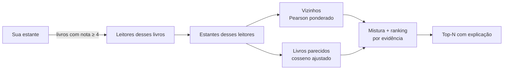

# skoob-recomenda

**Recomendações de livros a partir da sua estante do Skoob**: filtragem colaborativa híbrida, explicável, que roda na sua máquina.

[](https://github.com/ltmleo/skoob-recomenda/actions/workflows/ci.yml)
[](https://github.com/ltmleo/skoob-recomenda/releases)
[](go.mod)
[](LICENSE)

O `skoob-recomenda` instala o comando `recomenda`, que lê a sua estante, encontra leitores com gosto parecido com o seu e sugere o que ler a seguir. Cada sugestão vem com o motivo: *"porque você gostou de 1984 e A morte de Ivan Ilitch"*, *"12 leitores parecidos deram 5"*. Tudo fica no seu computador: não há servidor, conta nova nem envio de dados a terceiros.

## Destaques

- **Híbrido user-KNN + item-KNN**: combina "quem lê como você" com "livros parecidos com os que você amou".
- **Medido, não chutado**: `recomenda eval` compara os algoritmos com dados escondidos. O padrão atual tem o **dobro do nDCG** da versão original e bate o baseline de popularidade ([números](#qualidade)).
- **App local** com recomendações, estante, grafo interativo dos seus livros e navegação "quem gostou deste também gostou de…".
- **Expansão sob demanda**: busca no Skoob mais leitores de um livro específico e recalcula tudo.
- **Login seguro**: você digita a senha no próprio site, e a CLI só lê o cookie de sessão.
- **Um binário só**, sem dependências, para Linux, macOS e Windows.

## Instalação

**Binário pronto** (recomendado): baixe o arquivo do seu sistema em [Releases](https://github.com/ltmleo/skoob-recomenda/releases), descompacte e coloque o `recomenda` no `PATH`. Confira a integridade com o `checksums.txt`:

```bash
sha256sum -c checksums.txt --ignore-missing
```

**Com Go 1.25+:**

```bash
go install github.com/ltmleo/skoob-recomenda/cmd/recomenda@latest
```

**A partir do código:**

```bash
git clone https://github.com/ltmleo/skoob-recomenda && cd skoob-recomenda
go build -o recomenda ./cmd/recomenda
```

O login (`recomenda login`) precisa do Chrome ou Chromium instalado. O resto funciona sem ele.

## Início rápido

```bash
recomenda login     # abre o Chrome: entre na sua conta e a janela fecha sozinha
recomenda skoob     # baixa sua estante e a de leitores parecidos (5 a 10 min)
recomenda serve     # abre o app em http://127.0.0.1:8080
```

Sem conta no Skoob? Teste com os dados sintéticos, a partir do clone do repositório:

```bash
cd skoob-recomenda
go run ./cmd/recomenda run -data testdata/exemplo.csv -user 530077 -n 10
```

## Comandos

| Comando                  | O que faz |
|--------------------------|-----------|
| `recomenda login`        | Abre um Chrome com perfil temporário, espera você entrar no Skoob e salva o token. |
| `recomenda whoami`       | Valida a sessão e mostra o seu perfil. |
| `recomenda logout`       | Apaga o token salvo. |
| `recomenda skoob`        | Coleta sua estante + vizinhança, grava `skoob.csv` e gera `recomendacoes.html`. |
| `recomenda serve`        | App local no navegador, a partir do `skoob.csv`. |
| `recomenda run`          | Recomenda a partir de qualquer CSV, sem rede. |
| `recomenda eval`         | Mede a qualidade das recomendações (ver [Qualidade](#qualidade)). |
| `recomenda version`      | Mostra a versão. |

Os comandos com opções aceitam `-h`. Os principais ajustes:

| Flag | Padrão | Efeito |
|------|--------|--------|
| `-item-weight` | `0.5` | Peso do item-based na mistura (0 = só user-based, 1 = só item-based). |
| `-half-life` | `8760h` | Meia-vida do peso das suas leituras (`0` desliga). |
| `-k` | `50` | Número de leitores parecidos considerados. |
| `-max-per-author` | `3` | Máximo de sugestões do mesmo autor. |
| `-ranking` | `likes` | Ordem do top-N: `likes`, `deviation` ou `prediction`. |
| `-n` | `20` (`40` no `serve`) | Quantidade de recomendações. |

Lista completa: `-min-overlap`, `-min-support`, `-shrinkage`, `-amplify`, `-item-k`, `-item-shrinkage`, `-abandoned-stars`, `-pop-weight`. Na coleta (`skoob`): `-seeds`, `-readers`, `-max-users`, `-interval`, `-mine-only`.

## O app (`serve`)

- **Para você**: sugestões ordenadas pela nota prevista, com capa e motivo. Livros em "Quero ler" ou "Lendo" aparecem marcados; os lidos e abandonados não entram.
- **Minha estante**: filtros por status, busca e ordenação. Com login, a estante é atualizada do Skoob sempre que o app inicia.
- **Seguir um livro**: veja o que quem gostou de um livro também gostou, e vá clicando de livro em livro. A trilha fica no topo.
- **Grafo**: seus livros como nós, ligados quando os mesmos leitores leram os dois. Dá para arrastar, dar zoom e filtrar pelo mínimo de leitores em comum.
- **Expandir grafo**: busca no Skoob 20, 40 ou 80 leitores de um livro, baixa as estantes deles e recalcula tudo. Pode ser cancelada, e o que já veio é salvo.

As expansões regravam o `skoob.csv` e ficam registradas em `skoob.csv.expansoes.json`. Abas abertas se atualizam sozinhas. Sem login, o app funciona normalmente, só sem expandir.

## Como funciona



1. **Coleta (BFS limitada)**: a partir dos seus livros com nota alta, busca quem também os avaliou e baixa as estantes dessas pessoas. Só a vizinhança relevante é coletada, nunca o site inteiro.
2. **Peso temporal**: cada leitura sua pesa `0.5^(idade / meia-vida)`, então o que você leu recentemente define mais o seu gosto atual. Leituras sem data recebem a mediana dos pesos.
3. **Leitores parecidos (user-based)**: Pearson ponderado sobre notas centradas na média de cada pessoa (remove o viés de quem dá 5 para tudo), com *shrinkage* `n/(n+β)` para não confiar demais em quem tem poucos livros em comum.
4. **Livros parecidos (item-based)**: cosseno ajustado entre cada livro que você avaliou e cada candidato. Cobre os casos com poucos vizinhos e gera o "porque você gostou de X".
5. **Ranking**: a nota prevista mistura as duas abordagens, mas a escolha do top-N soma a evidência a favor (similaridade de quem gostou) sem normalizar. Ordenar só pela nota prevista favorecia livros de nicho que dois leitores amaram.
6. **Diversidade**: limite de livros por autor no top-N.

O código do algoritmo está em [`internal/recommend`](internal/recommend), com as fórmulas documentadas no topo de [`recommend.go`](internal/recommend/recommend.go).

## Qualidade

`recomenda eval` esconde 20% das notas de cada leitor, recomenda com o resto e confere se os livros escondidos de que ele gostou aparecem no top-20. O corte `-temporal` esconde as leituras mais recentes, que é o cenário real: "o que vou ler a seguir".

```bash
recomenda eval                        # popularidade × user-knn × item-knn × híbrido
recomenda eval -temporal -users -1    # todos os leitores, corte temporal
recomenda eval -grid                  # varre os parâmetros principais
```

Resultado numa coleta real (137 leitores testados; nDCG@20, maior é melhor):

| corte              | popularidade | algoritmo original | híbrido atual |
|--------------------|-------------:|-------------------:|--------------:|
| aleatório (seed 1) |        0,100 |              0,070 |     **0,144** |
| aleatório (seed 7) |        0,096 |              0,063 |     **0,131** |
| temporal           |        0,098 |              0,058 |     **0,111** |

Os padrões saíram dessas medições. Duas ideias testadas e reprovadas continuam disponíveis como opção, desligadas: tratar "abandonei" como nota baixa (`-abandoned-stars`) e misturar popularidade ao ranking (`-pop-weight`). Os números dependem dos dados de cada coleta: rode o `eval` na sua.

## Privacidade e segurança

- **Senha**: nunca passa pela CLI. O login abre o site do Skoob num Chrome com perfil temporário e isolado, e a CLI só lê o cookie de sessão pelo DevTools Protocol.
- **Token**: salvo em `~/.config/recomendador/token` com permissão `0600`, ou lido de `SKOOB_TOKEN`, que tem precedência (útil em servidores sem interface gráfica). Ele dá acesso total à sua conta: não compartilhe nem versione.
- **App local**: escuta só em `127.0.0.1`, recusa requisições com `Host` que não seja loopback (contra *DNS rebinding*) e recusa requisições de outros sites que alteram dados (contra CSRF). Com `-addr 0.0.0.0:8080`, o app fica aberto na rede, **sem senha**.
- **Dados**: `skoob.csv` e companhia ficam só na sua máquina e estão no `.gitignore`. Guardam IDs, notas e títulos, não nomes nem perfis.

Encontrou uma vulnerabilidade? Veja [SECURITY.md](SECURITY.md).

## Formato do CSV

```csv
user_id,book_id,title,author,rating,read_at,status,edition_id,cover
530077,duna,Duna,Frank Herbert,5,2026-10-01,read,,
```

Obrigatórias: `user_id`, `book_id`, `rating` (0,5 a 5; `0` = lido sem nota). As demais são opcionais: `read_at` (`YYYY-MM-DD`), `status` (`read`, `reading`, `want_to_read`, `abandoned`), `edition_id` e `cover`. Assim dá para usar o `recomenda run` com dados de qualquer fonte.

## Integração com o Skoob

O Skoob não tem API pública. O `recomenda` usa a mesma API que o site consome (`https://prd-api.skoob.com.br/api`), mapeada em 2026-11:

- `GET /v1/bookshelf?user_id=&page=&limit=`: estante, com nota, status e data;
- `GET /v1/book/{edition_id}/users-rated?page=&limit=`: quem avaliou uma edição;
- `GET /v1/user/profile`: o perfil logado.

Como esses endpoints não são documentados, podem mudar sem aviso. A coleta é gentil por padrão: uma requisição a cada 500 ms (`-interval`), respeito ao `Retry-After` e estantes de terceiros limitadas a 500 livros.

> **Aviso:** projeto independente, sem relação com o Skoob. Use com a sua própria conta, respeite os termos de uso do site e a LGPD, e não redistribua dados de outros leitores.

## Arquitetura

```
cmd/recomenda/      CLI (login, skoob, serve, run, eval)
internal/
  auth/             login pelo navegador (chromedp), token, perfil
  source/           de onde vêm as estantes: API do Skoob, CSV, memória
  crawl/            coleta BFS da vizinhança e expansão por livro
  recommend/        algoritmo híbrido, livros similares, baseline de popularidade
  eval/             avaliação offline (precision, recall, nDCG, MAE, cobertura)
  report/           relatório em texto e HTML
  web/              app local (API JSON + página única embutida)
  domain/           tipos centrais (Book, Rating)
```

O crawler e o algoritmo só conhecem a interface `source.Source`. Trocar o Skoob por outra fonte, ou por um mock nos testes, não toca no resto.

## Contribuindo

Contribuições são bem-vindas! O projeto segue **trunk-based development** com **Conventional Commits**: branches curtas, PR para a `main`, squash merge. Cada merge com `feat` ou `fix` vira um release automaticamente. Detalhes, ambiente e regras para mudar o algoritmo em [CONTRIBUTING.md](CONTRIBUTING.md).

```bash
go test ./... && go vet ./... && gofmt -l .
```

## Versionamento

[SemVer](https://semver.org/lang/pt-BR/), com versões geradas **só a partir da `main`**. Cada push na `main` passa por lint e testes em Linux, macOS e Windows. Se houver `feat`, `fix`, `perf` ou mudança incompatível desde a última versão, o pipeline cria a tag `vX.Y.Z` e publica o release com binários, checksums e notas. Branches de trabalho nunca geram versão. As mudanças de cada versão estão em [Releases](https://github.com/ltmleo/skoob-recomenda/releases).

## Licença

[MIT](LICENSE) © 2026 Leonardo Montero
